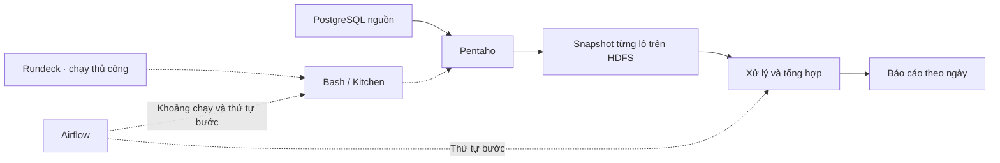

# Kiến trúc MVP

Thiết kế cho pipeline chạy theo lô. [Bài thực hành đầu tiên](INGESTION_LAB.md) đi từ PostgreSQL qua Spoon đến HDFS. Spark và Airflow là các mốc sau. [Lab CSV hiện có](../README.md#bắt-đầu-với-lab-spark-sql) đọc 12 dòng và có bộ kiểm tra riêng.

| Bước | Hợp đồng |
| --- | --- |
| PostgreSQL nguồn | Bảng giao dịch giả lập, một dòng mỗi `transaction_id`. Giữ `event_ts` cố định. Một thay đổi trạng thái phải có `updated_at` mới hơn phiên bản trước của giao dịch đó. |
| Pentaho | Dùng Table Input đọc theo khoảng `updated_at >= start` và `updated_at < end`. Lưu dữ liệu đã đọc theo khoảng chạy, kèm số dòng. |
| Staging HDFS | Lưu file theo khoảng lô. Khi ghép pipeline báo cáo, chỉ công bố snapshot sau khi ghi xong. Một lần phát lại dùng snapshot đã công bố. Một lô rỗng cũng có dấu hiệu hoàn thành rõ ràng để phân biệt với lỗi đọc nguồn. |
| Xử lý | Cập nhật bảng trạng thái dựa vào `transaction_id` và phiên bản mới hơn. Xác định ngày cần tính lại từ `event_ts` của các dòng staging, rồi tổng hợp từ **toàn bộ bảng trạng thái** cho các ngày đó. Dùng Spark SQL cho phần tổng hợp. |
| Báo cáo | Mỗi ngày có một kết quả chứa tổng số giao dịch, số thành công và tổng tiền thành công (VND). Ghi thay thế kết quả của từng ngày sau khi tính xong. |
| Airflow | Truyền cùng khoảng chạy xuống các bước. Retry hoặc chạy bù theo khoảng rõ ràng. Ghi vào log khoảng đọc, số dòng và các ngày đã công bố. |

Trong capstone, view nguồn lưu từng lần giao sự kiện. Chọn lô theo `received_at`, lấy bản mới nhất theo `version` và xác định ngày báo cáo theo `event_ts`. Hai CSV bổ sung cung cấp lịch sử phân hạng merchant và sao kê đối tác. Job Spark tạo bảng trạng thái, báo cáo doanh số và kết quả đối soát. [Hợp đồng và số liệu đối chiếu](../data/capstone/README.md)

## Hai mốc thời gian

- `updated_at` chọn **dòng nào cần đọc trong lô**.
- `event_ts` chọn **dòng đó thuộc ngày báo cáo nào**. Báo cáo và biên ngày của demo dùng múi giờ `Asia/Ho_Chi_Minh`. Dùng timestamp có múi giờ ở DB nguồn để các bước đối chiếu cùng mốc thời gian.

## Ca TX004

| Bước | Dữ liệu và kết quả mong đợi |
| --- | --- |
| Lô ngày 1 | TX004 phát sinh ngày 1, trị giá 70.000đ, trạng thái PENDING. Giao dịch có trong tổng số nhưng chưa góp vào tổng tiền thành công của ngày 1. |
| Lô ngày 2 | TX004 đổi sang SUCCESS và có `updated_at` ngày 2. Tính lại ngày 1. Số thành công tăng 1 và tổng tiền thành công tăng 70.000đ. |
| Phát lại lô ngày 2 | Tính lại ngày 1 từ bảng trạng thái. Kết quả giống lần chạy thành công trước đó. |
| Phát lại lô ngày 1 sau lô ngày 2 | Bản PENDING cũ không ghi đè bản SUCCESS mới hơn. Số liệu ngày 1 vẫn đúng. |

## Quyết định cho lần triển khai đầu

- **Lưu snapshot rồi mới xử lý.** PostgreSQL chỉ giữ trạng thái hiện tại của một giao dịch trong lab. Một lần truy vấn lại nguồn về sau có thể thấy bản mới hơn, nên snapshot là đầu vào để tái hiện chính xác một lần chạy cũ.
- **Tính lại số liệu theo ngày.** Báo cáo được tính từ bảng trạng thái đầy đủ rồi thay thế theo ngày. Cộng trực tiếp số của từng lô vào báo cáo sẽ làm tăng số liệu khi phát lại.
- **Kiểm tra cả sau khi đã cập nhật bảng trạng thái.** Nếu job lỗi trước khi công bố báo cáo, lần chạy lại vẫn lấy danh sách ngày từ staging dù phiên bản giao dịch đã được cập nhật trước đó.
- **Phạm vi nguồn thử nghiệm.** Demo kiểm soát thứ tự và thời điểm cập nhật. Khi mở rộng sang nguồn có ghi đồng thời, cần kiểm chứng chuyện thay đổi commit sau khi lô đã đọc và thiết kế cách thu nhận phù hợp.
